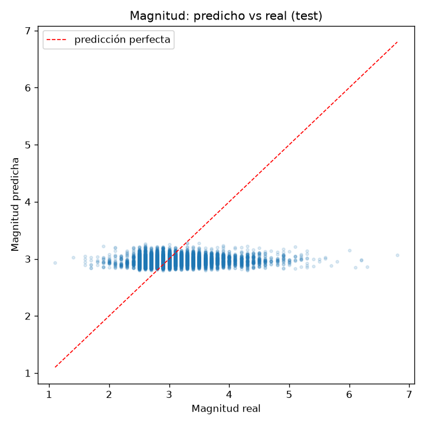

# Pronóstico sísmico en Chile con LSTM + Atención

Proyecto de *deep learning* que, a partir de los últimos 30 eventos del catálogo sísmico de Chile (2000 – nov 2023), estima dos cosas sobre el **siguiente evento registrado**:

- su **magnitud**, y
- el **tiempo de espera** hasta que ocurra (modelado como `log(1 + horas)`).

El modelo es una **LSTM multitarea con atención** (PyTorch). El proyecto incluye limpieza y control de calidad del catálogo, comparación contra *baselines* honestos, un control con etiquetas barajadas para detectar fuga de información y pruebas automáticas.

> ⚠️ **Aviso:** es un proyecto experimental/académico. No predice terremotos ni sirve como sistema de alerta. Predice la magnitud y el tiempo del *siguiente evento del catálogo* (la gran mayoría son sismos pequeños y réplicas), y su capacidad para superar a un baseline simple debe verificarse con los resultados (ver [Resultados](#resultados)).

---

## Estructura del repositorio

```
├── README.md
├── src/
│   ├── preprocesamiento.py   # limpieza, features, secuencias, split y normalización
│   ├── calidad_datos.py      # reporte de calidad del catálogo
│   ├── entrenamiento.py      # modelos, entrenamiento y baselines
│   ├── evaluacion.py         # métricas y gráficos sobre test
│   ├── experimentos.py       # diseño experimental con varias semillas
│   └── prediccion.py         # inferencia sobre los últimos eventos
├── tests/
│   └── test_proyecto.py      # pruebas con catálogo sintético
├── graficos/                 # imágenes (.png) generadas
└── resultados/               # reportes y métricas (.json, .csv)
```

---

## Datos

- **Archivo esperado:** `Dataset_Earthquake_Chile_2000_nov2023.csv` (separador `;`). No está incluido en el repositorio.
- **Columnas usadas:** `year, month, day, hour, minute, second, lat, long, z` (profundidad) y `magn1` (magnitud).
- **Período:** 2000 – noviembre 2023.

### Limpieza (`preprocesamiento.py`)

1. Construye un `datetime` real (incluyendo fracciones de segundo) y descarta fechas inválidas.
2. Filtra a **Chile continental** (lat −56 a −17, long −76 a −66). Esto elimina eventos del Territorio Chileno Antártico (presentes desde ~2020, con otra distribución espacial) y coordenadas imposibles.
3. Ordena cronológicamente y elimina duplicados exactos (mismo instante y ubicación).

### Features (18 por evento)

| Grupo | Variables |
|---|---|
| Evento | `lat`, `long`, `depth`, `magnitude` |
| Temporales | `log_dt_hours` (log1p de horas desde el evento anterior), `month_sin/cos`, `hour_sin/cos` |
| Espaciales | `dist_km` (Haversine al evento anterior), región tectónica *one-hot* (austral, sur, centro, norte chico, norte grande) |
| Contexto | `b_value` (Gutenberg-Richter móvil, ventana de 50 eventos), `prev_magnitude`, `prev_depth` |

### Secuencias y partición temporal

- Ventana deslizante de **30 eventos** → se predice el evento inmediatamente siguiente.
- Split **temporal** (sin mezclar el tiempo):

| Conjunto | Período del evento objetivo |
|---|---|
| Train | hasta 2018-12-31 |
| Validación | 2019-01-01 a 2021-12-31 |
| Test | desde 2022-01-01 |

- La normalización (media/desv. estándar) se ajusta **solo con train** para evitar fuga de información.

---

## Modelos (`entrenamiento.py`)

| Modelo | Descripción |
|---|---|
| `SismoLSTMAttention` | LSTM (64 unidades, 1 capa) + atención aditiva sobre todos los pasos + dos cabezas densas (magnitud y log-tiempo). Es el modelo principal; devuelve además los pesos de atención. |
| `SismoLSTM` | LSTM apilada (128 unidades, 2 capas) usando el último estado oculto + dos cabezas densas. |

Detalles de entrenamiento:

- Pérdida **Huber** con `delta=0.2` (se comporta como L1, alineada con el MAE). Pesos de pérdida: magnitud 1.0, tiempo 0.5.
- Sesgo inicial de las cabezas igual a la mediana de la magnitud y la media del log-tiempo de train.
- Adam (`lr=1e-3`), `ReduceLROnPlateau`, *gradient clipping* y *early stopping* (paciencia 5, máx. 30 épocas).
- Opción `use_magnitude_weights` para dar más peso a sismos grandes (desactivada por defecto porque sesgaba las predicciones hacia arriba).

### Baselines

El modelo debe superar al **mejor** de estos baselines, no solo a la media:

- media de train
- mediana de train
- persistencia (magnitud del último evento)
- promedio de la ventana

---

## Instalación

```bash
git clone https://github.com/fgomez2001/NOMBRE-DEL-REPO.git
cd NOMBRE-DEL-REPO
pip install numpy pandas matplotlib torch pytest
```

(Puedes generar un `requirements.txt` con `pip freeze > requirements.txt`.)

### Configurar rutas

Los scripts usan por defecto `C:\Users\gomez\Downloads`. Ajusta las rutas a tu entorno:

- `calidad_datos.py`, `experimentos.py` y `prediccion.py` leen la variable de entorno **`SISMOS_DIR`**.
- `preprocesamiento.py` (`RAW_PATH`, `OUTPUT_PATH`), `entrenamiento.py` (`DATA_PATH`, `MODEL_OUT_PATH`) y `evaluacion.py` (`DATA_PATH`, `MODEL_PATH`, `OUT_DIR`) tienen las rutas escritas dentro del archivo; edítalas al inicio de cada script.

```bash
# Linux / macOS
export SISMOS_DIR=/ruta/a/tus/datos
# Windows (PowerShell)
$env:SISMOS_DIR = "C:\ruta\a\tus\datos"
```

---

## Uso

Ejecuta los scripts en este orden (desde la carpeta `src/`, ya que se importan entre sí):

```bash
cd src

python preprocesamiento.py     # genera secuencias_sismos.npz
python calidad_datos.py        # genera reporte_calidad.json y calidad_datos.png
python entrenamiento.py        # entrena, compara con baselines y guarda modelo_sismos.pt
python evaluacion.py           # métricas y 4 gráficos sobre test
python experimentos.py --seeds 0 1 2   # comparación de configuraciones (varias semillas)
python prediccion.py           # predice el siguiente evento
```

Opciones útiles:

```bash
python calidad_datos.py --raw ruta/al/catalogo.csv
python experimentos.py --quick           # prueba rápida (3 épocas, 5000 muestras)
python experimentos.py --skip-models     # solo baselines
python prediccion.py --until 2023-06-30  # usa solo eventos hasta esa fecha
```

### Ejemplo de salida de `prediccion.py`

```
Última fecha usada : ...
Fecha estimada del siguiente evento: ...
Magnitud estimada  : ...
Espera estimada    : ... horas (... min)
Eventos de la ventana con mas atencion (0 = mas antiguo): [...]
```

---

## Control de calidad de datos (`calidad_datos.py`)

Genera `reporte_calidad.json` y `calidad_datos.png` con:

- conteo de filas, nulos, fechas inválidas, eventos fuera de Chile, magnitudes/profundidades imposibles y duplicados en los datos crudos;
- eventos por año y **magnitud de completitud (Mc)** por año;
- **desplazamiento de distribución** train vs. test (estadístico KS en magnitud, tiempo entre eventos y profundidad);
- alertas automáticas (cambio de Mc, KS > 0.1, pocos eventos M ≥ 5 en test).

---

## Diseño experimental (`experimentos.py`)

Pregunta: *¿una LSTM (con/sin atención, con/sin pesos por magnitud) predice magnitud y log-tiempo mejor que baselines simples?*

Configuraciones, cada una entrenada con varias semillas (se reporta media ± desv. estándar):

| Configuración | Arquitectura | Pesos por magnitud | Etiquetas barajadas |
|---|---|---|---|
| `lstm_atencion_ponderada` | Atención | Sí | No |
| `lstm_atencion_sin_pesos` | Atención | No | No |
| `lstm_apilada_sin_pesos` | LSTM apilada | No | No |
| `control_etiquetas_barajadas` | Atención | No | **Sí** (control negativo) |

El **control con etiquetas barajadas** sirve para detectar fuga de información: si ese modelo "aprende", hay un problema en el pipeline.

Métricas: MAE, RMSE y R² para magnitud y log-tiempo, además del MAE en sismos grandes (M ≥ 5).

Evidencia reproducible guardada: JSON por semilla, CSV resumen, hash SHA-256 del dataset y versiones de librerías.

---

## Resultados

Los resultados completos están en `resultados/`:

- `resumen_experimentos.csv` — tabla resumen por modelo
- `resultados_experimentos.json` — resultados por semilla y entorno
- `reporte_calidad.json` — reporte de calidad del catálogo

Gráficos generados en `graficos/`:

| Archivo | Contenido |
|---|---|
| `grafico_magnitud.png` | Magnitud predicha vs. real (test) |
| `errores_magnitud.png` | Histograma de residuos de magnitud |
| `serie_magnitud.png` | Real vs. predicho en los últimos 200 eventos de test |
| `grafico_tiempo.png` | log(1+horas) predicho vs. real |
| `calidad_datos.png` | Eventos por año y Mc estimada |
| `prediccion.png` | Salida de predicción |



<!-- Completa con tus métricas reales:

| Modelo | MAE magnitud | R² magnitud | MAE M5+ | MAE log-tiempo |
|---|---|---|---|---|
| Mejor baseline | | | | |
| LSTM + atención | | | | |
-->

---

## Pruebas

`tests/test_proyecto.py` usa un **catálogo sintético** (Gutenberg-Richter, b = 1) con errores inyectados a propósito (Antártica, latitud imposible, duplicados, fecha inválida), por lo que no depende del CSV real ni de GPU. Las pruebas que requieren PyTorch se omiten solas si no está instalado.

Cubren: limpieza, orden temporal, distancia Haversine, ausencia de NaN/inf, *one-hot* de región, forma de las secuencias, **ausencia de fuga de información (leakage)**, split temporal disjunto, scaler ajustado solo con train, formas de salida de los modelos, pesos por magnitud, capacidad de sobreajustar un lote pequeño, inicialización del sesgo y métricas.

```bash
# desde la raíz del repositorio (los tests importan módulos de src/)
# Linux / macOS
PYTHONPATH=src python -m pytest tests/ -v
# Windows (PowerShell)
$env:PYTHONPATH = "src"; python -m pytest tests/ -v
```

---

## Limitaciones

- El catálogo **no es homogéneo en el tiempo** (cambios en la red sísmica alteran la magnitud de completitud), lo que genera desplazamiento de distribución entre train y test.
- Hay **pocos eventos grandes (M ≥ 5)** en test, por lo que las métricas en sismos grandes son muy ruidosas.
- El `b_value` usa el mínimo de cada ventana como magnitud de completitud, lo que sesga su estimación; es solo un indicador de contexto.
- La predicción de magnitud tiende a la regresión a la media; por eso se compara siempre contra baselines.

---

## Tecnologías

Python · PyTorch · NumPy · pandas · Matplotlib · pytest

## Autor

[@fgomez2001](https://github.com/fgomez2001)
